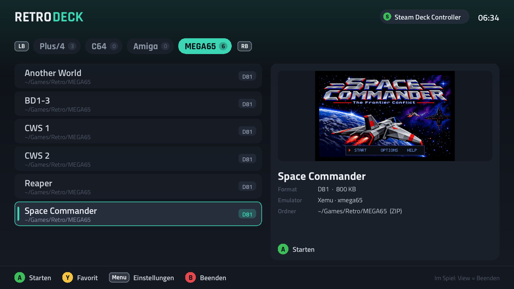
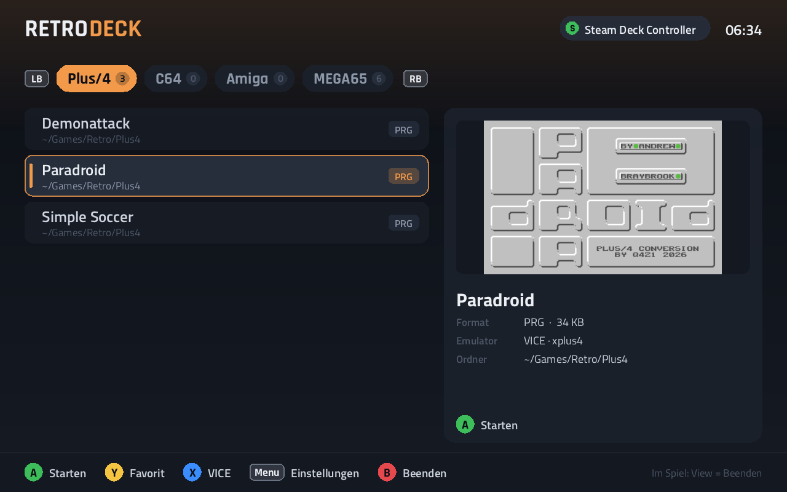

# RetroDeck

A launcher for **Plus/4**, **C64**, **Amiga** and **MEGA65** games, made for
the Steam Deck: pick a game with the controller, it starts fullscreen in its
emulator, and **View** asks whether to end it and go back. It runs in Steam's Game
Mode and on the desktop, on the Deck's own screen (1280×800) and on an
external one (1920×1080); the layout scales to whatever screen it gets.

All emulators are built from source into [toolchain/](toolchain/setup.sh);
nothing is installed on the system.



| | |
| --- | --- |
|  | On the Deck's own screen (1280×800) the same layout, scaled. The title screenshots come from the games themselves ([Title screenshots](#title-screenshots)); the shoulder buttons change the system. |

| System | Emulator | From |
| --- | --- | --- |
| Plus/4 | VICE 3.10 `xplus4` (or YapeSDL, X in the list switches) | `toolchain/vice/`, `toolchain/bin/yapesdl` |
| C64 | VICE 3.10 `x64sc` | `toolchain/vice/` |
| Amiga | `retrodeck-amiga`: RetroDeck's own front end on the vAmiga core, A500 with your Kickstart 1.3 | `build/bin/`, core in `toolchain/src/vAmiga`, Kickstart in the Amiga games folder |
| MEGA65 | Xemu `xmega65` (our fork) with the MEGA65 ROM 920413 | `toolchain/bin/xmega65` |

## Building

```sh
./build.sh
```

does everything on the host, also when started from VS Code's Flatpak
terminal: `toolchain/setup.sh` builds what is missing, then CMake builds the
launcher and the Amiga front end into `build/bin/`. The first run takes a
while (VICE, the vAmiga core, the 268 MB for the MEGA65 ROM); after that
only what changed is rebuilt.

`toolchain/setup.sh` first checks the build tools the system needs (gcc,
cmake, make, pkg-config, git, curl, flex, bison, python, bsdtar, SDL2,
zlib) and, if some are missing, names them with the `pacman` line that
installs them; it installs nothing itself. Then it takes everything from
the net, at pinned versions:

| Piece | Source |
| --- | --- |
| VICE 3.10 | release tarball from SourceForge, SDL2 user interface, installed into `toolchain/vice/` |
| xa 2.4.1, dos2unix | only for building VICE; xa from floodgap.com, dos2unix a stand-in script; both stay in `toolchain/src/shims/` |
| YapeSDL | [q4z1/yapesdl](https://github.com/q4z1/yapesdl), branch `feature/start-fullscreen` (`YAPE_FULLSCREEN=1` opens it fullscreen) |
| Xemu | [q4z1/xemu](https://github.com/q4z1/xemu), branch `audio-sync`, with the changes in `toolchain/patches/` applied to the clone: its window opens centered (see [Screens](#screens)), and `-hdosvirt`'s readfile maps the SD-card buffer at `$DE00` as Hyppo does (see [MEGA65 games with data files](#mega65-games-with-data-files)) |
| vAmiga core | [dirkwhoffmann/vAmiga](https://github.com/dirkwhoffmann/vAmiga), the same commit as `amiga-run` in [q4z1/MEGA65](https://github.com/q4z1/MEGA65) |
| `MEGA65.ROM` | built as mega65go does on Windows: the C65 ROM 910828 out of Cloanto's C64 Forever installer, patched with 920413.bdf from files.mega65.org, both checked by SHA-1; with cabextract 1.11 (cabextract.org.uk, built here), olefile 0.47 (GitHub) and the two scripts in `toolchain/tools/` (`msi-extract-cabs.py`, `bspatch.py`, part of this repository, taken over from [q4z1/MEGA65](https://github.com/q4z1/MEGA65)) |

Only the Amiga's **Kickstart ROM** is not on the net (it may not be passed
on): your own copy goes into the Amiga folder of the games (see
[The games folder](#the-games-folder)), where the launcher finds it by
"kick" in its name.

YapeSDL and Xemu are built anew when their pinned commit or a patch
changes (`toolchain/bin/*.stamp`). If a pinned commit cannot be fetched (not
pushed yet, or offline), the build that is there is kept with a warning.
`toolchain/setup.sh vice` (or `yapesdl`, `xemu`, `vamiga`, `rom`) does one
piece only. VICE finds its ROMs through the path it was built for, so
after moving the RetroDeck folder, delete `toolchain/vice/` and build
again.

## Into Steam and Game Mode

1. `./install-desktop-entry.sh` puts RetroDeck into the application menu.
2. In Desktop Mode, Steam → *Add a Game* → *Add a Non-Steam Game…* → tick
   **RetroDeck**. (Or add `retrodeck.sh` by hand.)
3. In Game Mode it is in the library under *Non-Steam*. For an external
   screen, set the game's resolution to *Native* or 1920×1080 in its
   properties; the launcher and the emulators follow the screen.

The controller layout in Steam can stay the default *Gamepad*.

## Controls

In the launcher:

| Controller | Keyboard | |
| --- | --- | --- |
| D-pad / left stick | arrows | choose a game; left/right change the system |
| LB / RB | Q / E, Tab | previous / next system |
| LT / RT | Page up / down | eight games up / down |
| A | Enter | start |
| Y | F | favorite (favorites come first) |
| X | X | Plus/4: VICE or YapeSDL |
| Menu (Start) | M, F1 | settings |
| B | Escape | quit RetroDeck |

In every emulator, **View** (pressed on its own) pauses the game and asks
*"… beenden?"*: **A** ends it and returns to the list, **B** or View again
plays on. **View + Menu held for a second** ends it without asking.

The question comes from the launcher, so it is the same for all emulators:
it freezes the emulator's processes (`SIGSTOP`), shows its own window in
front with the game's screenshot behind the question, and hides it again
and lets the emulator go on (`SIGCONT`) for B. What is pressed while the
question is up reaches the emulator afterwards as well, so B there may fire
once in a C64 or Plus/4 game.

| | VICE (C64, Plus/4) | Amiga | MEGA65 (Xemu) |
| --- | --- | --- | --- |
| Stick, D-pad | joystick | joystick port 2 | joystick |
| A | fire | fire | fire |
| B | fire | Space | fire |
| X / Y | – | Return / F1 | fire |
| Menu | VICE's menu (disks, reset, virtual keyboard) | P (pause) | – |
| Right stick, RT / LT | – | mouse, left / right button | – |
| View + LB / RB | – | previous / next disk in DF0 | – |
| View + Y | – | turbo on/off | – |

The Amiga runs at normal speed also while its drive loads: vAmiga's
automatic warp would mute the music many games play while loading.
View + Y switches warp on and off by hand. Its keyboard is the PC keyboard (also Steam's on-screen
keyboard, Steam + X); F11 switches fullscreen, F12 quits.

## Controllers

The **Controller** setting decides which controller plays: *Automatic* is
the one that pressed A on the game, or one controller by name (e.g. the Xbox
controller paired over Bluetooth). The emulator then gets to see only that
one: the others are hidden from it with `SDL_GAMECONTROLLER_IGNORE_DEVICES`,
and VICE and the Amiga front end are given its number. The Deck's built-in
controller is always hidden when another one plays, since its motion sensors
send all the time.

VICE reads controllers by raw button and axis numbers, which differ between
controllers (the Deck's own, Steam's virtual gamepad, an Xbox controller).
The launcher writes VICE's joystick map from SDL's controller mapping of the
controller in use on every start (`~/.config/retrodeck/vice/retrodeck.vjm`),
so A is fire and Menu is VICE's menu on all of them.

*Joystick port* switches C64 and Plus/4 games between port 2 (most games)
and port 1.

In Game Mode, Steam shows every controller as a "Steam Virtual Gamepad" with
the same vendor and product; they cannot be hidden from each other by that,
so Xemu (which takes every joystick as its one joystick) sees all of them
there. VICE and the Amiga still take only the chosen one.

## Screens

A game always opens on the screen RetroDeck is on. In Game Mode there is
only one; on the desktop with several (e.g. two monitors on the dock),
the launcher finds the connector of its screen (DP-3, HDMI-A-1, …) and
starts the emulator with `SDL_VIDEO_DISPLAY_PRIORITY=<connector>`, which
makes that screen SDL's first: windows opened centered, and fullscreen,
go there (SDL 3.2 and later, also through sdl2-compat). Under Wayland SDL
names screens by their model only, so the connector is found through the
monitor's name in its EDID (`/sys/class/drm/card*-*/edid`); two monitors of
the same model cannot be told apart that way.

All emulators open centered: the Amiga front end and YapeSDL do anyway,
VICE is told with `-windowxpos/-windowypos`, and RetroDeck's copy of Xemu is
changed to (without it, KWin places Xemu's window where it likes).

The setting **Bildschirm** chooses the screen for RetroDeck itself:
*automatic* (where it was opened) or a connector. Changing it moves the
launcher there at once, and it opens there from then on.

## MEGA65 games with data files

Some MEGA65 games load a big file from the SD card next to their D81:
Another World its `anotherw.dat`, Space Commander its `SPACE.SCP`. Their
READMEs say to copy both onto the card. RetroDeck does without that: it
starts Xemu with `-hdosvirt -hdosdir <folder>`, so that Hyppo's file
functions see a folder on the PC as the card. That folder is
`~/.cache/retrodeck/mega65-sd/<game>/`, with a link to every file beside the
D81 (or in its ZIP, which is unpacked whole), also under its name in lower
case – the MEGA65 asks for `space.scp`, and Linux tells that apart from
`SPACE.SCP`. Files a game writes there stay in that folder.

Xemu's virtual readfile put the data into the SD-card buffer but left the
F011 buffer mapped at `$DE00`, so Space Commander read the D81's sector
instead and reported a wrong `SPACE.SCP`; `patches/xemu-hdos-readfile-buffer.patch`
maps the SD-card buffer, as Hyppo does.

## The games folder

The games live in one folder, `~/Games/Retro`, with a folder per system:

```
~/Games/Retro/
├── Plus4/     PRG D64 D81 T64 TAP
├── C64/       PRG D64 D71 D81 G64 T64 TAP CRT
├── Amiga/     ADF ADZ DMS – and your Kickstart ROM (a .rom or .bin with "kick" in its name)
└── MEGA65/    PRG D81 – with the files a game loads from the SD card next to its D81
```

All of them also inside ZIP archives, and in subfolders up to three levels
deep. A MEGA65 game's ZIP is unpacked whole when it starts, so its data
files (Another World's `anotherw.dat`, Space Commander's `SPACE.SCP`) come
along.

[make-games-folder.sh](make-games-folder.sh) lays out this structure
anywhere, e.g. on an SD card:

```sh
./make-games-folder.sh ~/Games/Retro             # the folders only
./make-games-folder.sh --use /run/media/deck/SD/Retro   # and library.conf points there
```

`--use` replaces the folder in library.conf's lines for the four systems
that end in `/Plus4`, `/C64`, `/Amiga` or `/MEGA65` (options like
`exclude=` stay); other lines stay as they are. Then Menu → *Bibliothek neu
einlesen*.

## The library

[library.conf](library.conf) says which folders hold which system's games,
searched three levels deep, and can name more folders:

```
plus4   ~/Games/Retro/Plus4
c64     ~/Games/Retro/C64
amiga   ~/Games/Retro/Amiga
mega65  ~/Games/Retro/MEGA65
```

ZIP archives are looked into, unless they lie unpacked next to themselves
(beside the ZIP or in a folder named like it), so a game is not listed
twice. TOSEC names become title and details ("Lotus Esprit Turbo
Challenge", "1990 · Gremlin"); an 8.3 name cut from its folder's takes the
folder's ("anotherw.d81" in `AnotherWorld/` is "Another World"); Amiga disks
named "… (Disk 1 of 3)" become one game. Other disks of a game, which are
no game of their own (a second or a save disk), can be left out with
`exclude=`. A screenshot is shown if there is a `<name>.png` next to the file
or a `screenshots/` folder beside it or up to two levels above.

After changing the file: Menu → *Bibliothek neu einlesen*.

### Title screenshots

```sh
build/bin/retrodeck --make-screenshots                                  # for every game without one
build/bin/retrodeck --make-screenshots --system 0 --select 1 --seconds 9  # one game anew
```

runs each game without a screen or sound for some seconds of its time and
keeps its last picture in `~/.local/share/retrodeck/screenshots/<system>/<file>.png`,
which the list then shows (before a `<name>.png` or `screenshots/` folder
beside the game). VICE (also for Plus/4 games) runs in warp for a number of
cycles and writes the PRG straight into memory (`-autostartprgmode 1`), Xemu
runs headless and as fast as it can, the Amiga in real time. The defaults
are 25 s (C64, Plus/4), 30 s (MEGA65) and 40 s (Amiga); a game whose title is
earlier or later, or comes and goes with a demo, gets its own `--seconds`
(Paradroid: 9). Titles behind a question (Another World's code wheel) are
out of reach this way. The list cuts a frame in one colour off the
pictures, such as the black around Xemu's.

## Files

| Path | What |
| --- | --- |
| `src/launcher/` | the launcher: list and screens (`main.cpp`), library scan (`library.cpp`, `zip.cpp`), controllers (`pads.cpp`), screens (`displays.cpp`), command lines and processes (`emulators.cpp`), settings |
| `src/amiga/main.cpp` | the Amiga front end on the vAmiga core |
| `src/common/` | text (stb_truetype), shapes and images, shared by both |
| `third_party/stb/` | stb_truetype, stb_image, stb_image_write (public domain), pinned commit in `VERSION` |
| `assets/fonts/` | Rajdhani and Titillium Web (SIL Open Font License, licence texts beside them), from [google/fonts](https://github.com/google/fonts) |
| `~/.config/retrodeck/` | settings, favorites, VICE's settings (`vice/sdl-vicerc`) |
| `~/.cache/retrodeck/` | games unpacked from ZIPs (anew when a ZIP is replaced), `last-run.log` (the emulator's output of the last start) |

For checking things without a screen:

```sh
build/bin/retrodeck --dry-run --system 2 --select 0       # how that game would start
SDL_VIDEODRIVER=offscreen build/bin/retrodeck --window 1920x1080 --screenshot shot.png
```

## License

RetroDeck is free software under the [GNU General Public License v3.0](LICENSE)
or later.

What it uses keeps its own license: the vAmiga core (MPL-2.0, its CPU Moira
MIT), linked into `retrodeck-amiga`; stb (public domain); the fonts (SIL Open
Font License, texts in `assets/fonts/`). VICE, Xemu and YapeSDL (GPL-2.0) are
programs of their own that RetroDeck builds and starts; the patches in
`toolchain/patches/` change Xemu and are under its license. ROMs are not part
of RetroDeck: the MEGA65 ROM is built on your machine from Cloanto's
installer, and the Kickstart is your own copy.

## How this was made

Ideas, design and direction come from decades of programming experience; the
implementation made intensive use of AI ([Claude](https://claude.ai) by Anthropic).
